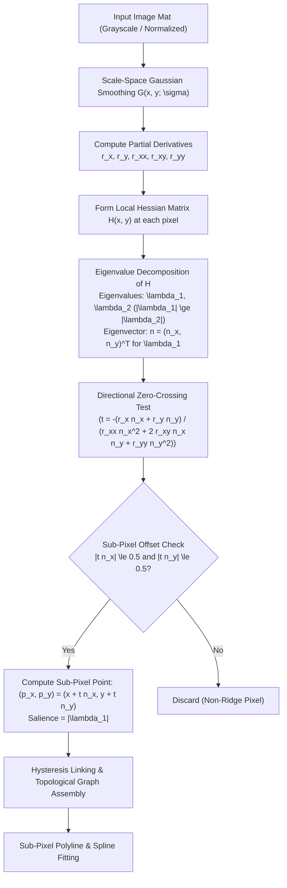
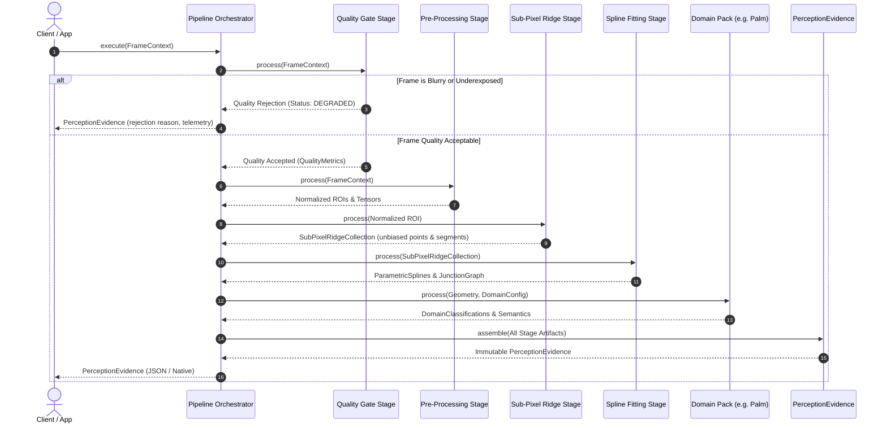

# System Architecture Specification

> **Target Repository**: `vision-perception`  
> **Architecture Version**: 1.0.0  
> **Status**: Approved Architectural Blueprint  

---

## 1. Architectural Philosophy & Vision

The `vision-perception` engine is a modular, high-performance computer vision monorepo implemented in **modern C++ (C++20)** with **OpenCV**. 

### 1.1. North Star: The Agnostic Core
The central architectural invariant is **strict domain-agnosticism**:

```text
+-----------------------------------------------------------------------------------+
|                              DOMAIN PACKS (L3)                                    |
|   Palm Analysis  |  Poultry Tracking  |  Surface Inspection  |  Driver Monitoring |
+-----------------------------------------------------------------------------------+
                                         |
                                         v
+-----------------------------------------------------------------------------------+
|                              ADAPTERS LAYER (L2)                                  |
|   OpenCV Adapter  |  ONNX Runtime Adapter  |  ByteTrack Adapter  |  Camera I/O    |
+-----------------------------------------------------------------------------------+
                                         |
                                         v
+-----------------------------------------------------------------------------------+
|                           VISION-PERCEPTION CORE (L1)                             |
|  Curvilinear Ridge Engine | Sub-Pixel Geometry | Quality Gating | Evidence Model  |
+-----------------------------------------------------------------------------------+
```

- **What lives in the Core (`core/`)**:
  - Pure mathematical, topological, radiometric, and geometric algorithms.
  - Scale-space differential geometry (Gaussian derivatives, Hessian matrix tensor analysis, eigenvalue decomposition).
  - Unbiased sub-pixel ridge and valley extraction (Steger formulation).
  - Sub-pixel curve linking, hysteresis tracing, and spline parameterization.
  - General image quality metrics (Laplacian focus variance, dynamic range, illumination uniformity).
  - The universal, immutable **PerceptionEvidence** model and serialization contract.
- **What is strictly FORBIDDEN in the Core**:
  - Any domain-specific vocabulary, rules, or heuristics (e.g., palm lines, heart line, head line, poultry feeding states, crack defect severity classification, driver drowsiness thresholds, astrological or biometrics interpretations).
  - Direct hardware coupling or hardcoded file paths.
  - Stray diagnostic logging (`printf`, `std::cout`, `std::cerr`).

---

## 2. Monorepo Directory Topology

The monorepo enforces a strict multi-tier directory structure:

```text
vision-perception/
├── core/                   # Tier 1: Domain-Agnostic Vision Engine
│   ├── geometry/           # Sub-pixel points, lines, polylines, bounding boxes, splines
│   ├── ridge/              # Steger sub-pixel curvilinear ridge extraction pipeline
│   ├── quality/            # Frame focus, blur, exposure, and perceptual gating
│   ├── pipeline/           # Abstract stage interfaces, DAG orchestrator, telemetry
│   └── evidence/           # Immutable PerceptionEvidence data schema and serialization
│
├── adapters/               # Tier 2: Technology & Hardware Abstraction
│   ├── opencv/             # OpenCV Mat wrappers, color space conversions, morphological filters
│   ├── inference/          # Deep learning runtime adapters (ONNX Runtime, TFLite)
│   ├── tracking/           # Multi-object association and Kalman filtering (ByteTrack)
│   └── io/                 # Video stream, image reader, camera device abstractions
│
├── domains/                # Tier 3: Isolated Domain Extension Packs
│   ├── palm/               # Hand ROI extraction, crease analysis, landmark mapping
│   ├── poultry/            # Bird tracking, spatial density, behavior classification
│   ├── surface_inspection/ # Industrial scratch, crack, and anomaly surface analysis
│   ├── driver_monitoring/  # Gaze tracking, head pose, eye closure detection
│   └── document_scanning/  # Quad boundary detection, perspective flattening, binarization
│
├── apps/                   # Standalone Executables & Production Services
│   ├── cli/                # Command-line tool for static batch and video evaluation
│   ├── demo_gui/           # Desktop visualizer for real-time pipeline inspection
│   └── service/            # Edge daemon / gRPC / REST pipeline microservice
│
├── tools/                  # Developer, Calibration & Research Tooling
│   ├── benchmark/          # Micro-benchmarking harness (Google Benchmark)
│   ├── calibration/        # Camera intrinsics, distortion correction, homography calibrators
│   └── synth_generator/    # Synthetic curved ridge generator with known ground truth
│
├── models/                 # Neural Network Models & Schemas
│   ├── manifests/          # Model metadata, license, hash verification (JSON)
│   └── schemas/            # Tensor input/output signatures and preprocessing specs
│
├── data/                   # Fixtures & Verification Assets
│   ├── fixtures/           # Small golden unit test images and synthetic curves
│   └── samples/            # Example images for integration verification
│
├── third_party/            # External Permissive Dependencies
│   └── spline/             # Vendored single-header cubic spline interpolation
│
├── docs/                   # Engineering & Governance Documentation
│   ├── architecture.md     # This document
│   ├── license_policy.md   # IP, license rules, provenance requirements
│   ├── roadmap.md          # Multi-milestone delivery schedule
│   └── research/           # Open-source evaluations, literature reviews, benchmarks
│
└── scripts/                # Developer Environment & CI Automation
    ├── setup_env.sh        # Dependency installation script (macOS/Linux)
    ├── run_tests.sh        # Automated test execution and coverage reporting
    ├── format.sh           # clang-format and clang-tidy lint enforcement
    └── download_models.sh  # Script for fetching versioned model weights
```

---

## 3. Core Engine: Sub-Pixel Curvilinear Ridge Extraction

The primary perception workload of `core/ridge/` is extracting curvilinear structures (centerline position, width, direction, and intensity profile) with sub-pixel precision.

### 3.1. Mathematical Formulation (Steger Formulation)
Given a 2D continuous image function $I(x, y)$, a curvilinear structure appears as a ridge or valley where the directional derivative along the direction of maximum curvature reaches zero, and the second directional derivative is a local extreme.



1. **Gaussian Derivatives**: Image is convolved with first and second partial derivatives of a 2D Gaussian kernel of standard deviation $\sigma$:
   $$r_x = I * G_x(\sigma), \quad r_y = I * G_y(\sigma)$$
   $$r_{xx} = I * G_{xx}(\sigma), \quad r_{xy} = I * G_{xy}(\sigma), \quad r_{yy} = I * G_{yy}(\sigma)$$
2. **Hessian Eigenvalue Decomposition**: At each candidate pixel $(x, y)$, the 2D Hessian matrix is formed:
   $$H(x, y) = \begin{pmatrix} r_{xx} & r_{xy} \\ r_{xy} & r_{yy} \end{pmatrix}$$
   The eigenvectors $(n_x, n_y)$ specify the direction perpendicular to the line, and the dominant eigenvalue $\lambda_1$ signifies ridge strength.
3. **Sub-Pixel Extrema Localization**: A second-order Taylor expansion along the normal direction $n$ yields the sub-pixel offset $t$:
   $$t = -\frac{r_x n_x + r_y n_y}{r_{xx} n_x^2 + 2 r_{xy} n_x n_y + r_{yy} n_y^2}$$
   If $(t n_x, t n_y) \in [-\frac{1}{2}, \frac{1}{2}] \times [-\frac{1}{2}, \frac{1}{2}]$, a sub-pixel ridge point is localized at:
   $$(p_x, p_y) = (x + t n_x, y + t n_y)$$
4. **Hysteresis Linking**: Ridge points exceeding high-threshold $\sigma_{\text{high}}$ seed polylines, linked along the tangent direction down to low-threshold $\sigma_{\text{low}}$, eliminating spurious noise.

---

## 4. Pipeline Data Flow & Execution Graph

The pipeline follows a Directed Acyclic Graph (DAG) pattern where each processing unit implements a standardized `IPipelineStage` interface.



---

## 5. The PerceptionEvidence Model Specification

Every execution of a `vision-perception` pipeline outputs a strongly-typed, immutable `PerceptionEvidence` object. This schema completely decouples perception computation from downstream presentation, analytics, or storage.

```cpp
namespace vision::core::evidence {

struct Point2DSubpixel {
    double x{0.0};
    double y{0.0};
    double confidence{0.0};
    double response{0.0}; // Salience (|lambda_1|)
    double normal_angle{0.0}; // Radians
};

struct RidgeSegment {
    uint64_t id{0};
    std::vector<Point2DSubpixel> points;
    double average_width{0.0};
    double total_length{0.0};
    double aggregate_confidence{0.0};
};

struct FrameQualityAssessment {
    bool passed{false};
    double laplacian_focus_score{0.0};
    double illumination_uniformity{0.0};
    double contrast_ratio{0.0};
    double brisque_score{0.0};
    std::vector<std::string> rejection_reasons;
};

struct PipelineTelemetry {
    std::chrono::microseconds total_duration{0};
    std::unordered_map<std::string, std::chrono::microseconds> stage_durations;
    std::string engine_version;
};

struct PerceptionEvidence {
    std::string session_id;
    uint64_t frame_index{0};
    int64_t timestamp_utc_ms{0};
    
    FrameQualityAssessment quality;
    std::vector<RidgeSegment> ridges;
    
    // Extensible domain-specific payload container (key-value / JSON node)
    std::unordered_map<std::string, std::string> domain_attributes;
    
    PipelineTelemetry telemetry;
    
    [[nodiscard]] std::string to_json() const;
};

} // namespace vision::core::evidence
```

---

## 6. Domain Pack Architecture (Extensibility Contract)

Domain packs are decoupled consumer modules located in `domains/`. They receive geometric and radiometric evidence from the core and apply domain-specific rules.

### 6.1. Domain Plugin Contract
Every domain pack implements the `IDomainPack` interface:

```cpp
namespace vision::domains {

class IDomainPack {
public:
    virtual ~IDomainPack() = default;
    
    [[nodiscard]] virtual std::string name() const noexcept = 0;
    [[nodiscard]] virtual std::string version() const noexcept = 0;
    
    virtual void configure(const DomainConfig& config) = 0;
    
    [[nodiscard]] virtual DomainResult process(
        const core::evidence::PerceptionEvidence& evidence,
        const cv::Mat& source_frame) = 0;
};

} // namespace vision::domains
```

### 6.2. Domain Pack Examples
1. **`domains/palm`**: Consumes hand ROI landmarks, maps extracted curvilinear ridges to anatomic palm creases (Heart Line, Head Line, Life Line, Fate Line), extracts minutiae, calculates crease depth profiles.
2. **`domains/poultry`**: Consumes object tracking boxes and motion vectors, computes flock velocity vectors, clustering density, feeder dwell times, and anomaly movement flags.
3. **`domains/surface_inspection`**: Consumes high-curvature ridge anomalies, clusters structural surface imperfections (cracks, micro-scratches, pinholes), outputs defect severity scores.
4. **`domains/driver_monitoring`**: Consumes face landmarks, evaluates eye aspect ratio (EAR), gaze vector, head orientation (yaw, pitch, roll), calculates distraction and drowsiness risk.
5. **`domains/document_scanning`**: Detects quadrilateral paper boundaries, computes planar homography, performs perspective rectification, shadow attenuation, and adaptive binarization.

---

## 7. C++ Standards & Engineering Guidelines

1. **Language Standard**: Modern **C++20** (`-std=c++20`).
2. **Memory Safety**:
   - Zero raw `new` / `delete`. Strict adherence to RAII.
   - Use `std::unique_ptr` for exclusive ownership, `std::shared_ptr` only for shared pipeline resources.
   - Use `std::span` and `std::string_view` to prevent unnecessary allocations and memory copies.
3. **Error Handling**:
   - Return `std::expected<T, CoreError>` or clean result structs for expected runtime pipeline failures (e.g., quality reject, zero ridges detected).
   - Reserve exceptions strictly for non-recoverable system errors (e.g., memory allocation exhaustion, corrupted model weights).
4. **Logging Discipline**:
   - Zero `printf`, `std::cout`, or `std::cerr` in core code.
   - Logging is injected via a lightweight callback or diagnostic logger interface (`ILogger`).
5. **Testability**:
    - 100% of core algorithms must be unit-testable without camera hardware or external network access.
    - Synthetic mathematical curves (parabolas, circles, sine waves) with known analytical ground truth must validate sub-pixel accuracy down to $< 0.1$ pixel.

---

## 8. Product Principle: Prediction-First, Human-in-the-Loop

Detection serves prediction; the user buys a result, never lines or
confidences. The app is a helper: it proposes geometry, the human corrects it
with cheap edits, and the confirmed geometry feeds the prediction layer (palm
reading, flood alert). Confirmations accumulate as training labels so proposals
improve gradually; full automation is the end state, never the entry gate.
Full statement: [`docs/product_vision.md`](product_vision.md).
