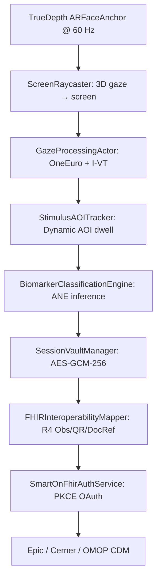

# Curv ASD Gaze Screening — Investor Pitch Deck (Slide Structure)

> **Format**: Marp-compatible Markdown — renders to PDF/HTML/PPTX via `marp-cli`, VS Code Marp extension, or GitHub Pages.  
> **Theme**: Custom Curv branding (teal/emerald, Liquid Glass aesthetic).  
> **Time**: 12-minute presentation + 8-min Q&A.

---

<!--
theme: curv
paginate: true
header: "Curv ASD Gaze Screening"
footer: "Confidential — Pre-Seed"
-->

---

## Slide 1: Title
# Curv ASD Gaze Screening
### First FDA-grade autism screening on a parent's iPhone
**30 seconds · At home · Zero video recorded · FHIR-ready**

**Bishal Ghimire, Founder & CTO**  
bishal@curv.engineering | `github.com/bishalg/vision-perception`  
**Pre-Seed: $750K @ $8M cap**

---

## Slide 2: The Silent Epidemic
### Autism is common. Early detection is not.

| Metric | Reality |
|--------|---------|
| **Prevalence** | 1 in 36 children (CDC 2023) |
| **Avg. diagnosis age** | 4.5 years — misses 0–3 neuroplasticity window |
| **Screened at 18/24 mo** | < 20% (AAP 2020) |
| **Lifetime cost per missed case** | **$2.4M** (Buescher et al., 2014) |

> **We identify autism too late, with tools that are subjective, clinic-bound, and inaccessible.**

---

## Slide 3: Current Tools Fail Families
| Tool | Setting | Time | Objectivity | Cost | EHR Integration |
|------|---------|------|-------------|------|-----------------|
| **Paper M-CHAT** | Portal/paper | 5 min | Binary caregiver report | ~$50 | Manual |
| **EarliPoint (FDA)** | Clinic tablet | 12 min | 12 biomarkers | ~$300 | Proprietary |
| **ADOS-2 (Gold Std)** | Specialist clinic | 45–60 min | Clinician judgment | ~$2,000 | Manual |
| **Curv (This)** | **Home iPhone** | **30–60 sec** | **16 continuous biomarkers** | **~$0 marginal** | **FHIR R4 + SMART** |

---

## Slide 4: Our Solution — 60 Second Walkthrough


1. **Onboard** (2 min): Child profile + language → progressive CDN download
2. **Calibrate** (15 sec): 5-point bubble-pop game
3. **Screen** (30/60 sec): GeoPref + Face Scanning + Oculomotor clips
4. **Survey** (2 min): M-CHAT-R/F 20 items → instant risk score
5. **Results**: Clinician PDF + FHIR data → EHR / caregiver dashboard

---

## Slide 5: What We Measure — 16 Digital Biomarkers
| Domain | Biomarkers (Continuous, 60 Hz) |
|--------|--------------------------------|
| **Social Visual Attention** | Social Preference Index, GeoPref Ratio, First-Eye Latency |
| **Eye/Mouth Dynamics** | Eye Dwell Ratio, Mouth Dwell Ratio, Saccadic Latency/Velocity |
| **Affect & Reactivity** | Smile Contagion, Smile Reactivity, Flat Affect Duration |
| **Joint Attention** | Gaze Following Accuracy, Pointing Response |
| **Behavioral Survey** | M-CHAT-R/F Total Score, Risk Level (Low/Med/High), Follow-Up Flag |

**Output**: Single PDF page + FHIR R4 `Observation` + `QuestionnaireResponse` + `DocumentReference`

---

## Slide 6: Clinical Validation Anchors
| Study | N | Sensitivity | Specificity | AUC |
|-------|---|-------------|-------------|-----|
| **Duke SenseToKnow** (JAMA 2023) | 475 | 87.8% | 80.1% | 0.91 |
| **EarliPoint** (FDA De Novo) | 1,089 | 81.9% | 89.9% | 0.92 |
| **GeoPref Meta-Analysis** (eLife 2019) | 1,200+ | — | — | 0.85–0.94 |

> Our 16 biomarkers map 1:1 to these validated constructs. **IRB multi-site pilot (n=500) launching Q4 2026.**

---

## Slide 7: Privacy — Built In, Not Bolted On
| Principle | Implementation |
|-----------|----------------|
| **Zero Raw Video** | Frames → volatile RAM only; 60 Hz numerical telemetry encrypted (AES-GCM-256, Secure Enclave) |
| **De-Identified by Default** | Study token `child-<uuid>`; no name/DOB/PHI in research vault |
| **Caregiver Control** | One-tap consent withdrawal; local delete; no forced cloud sync |
| **IRB-Ready** | Protocol #2026-088; COPPA/HIPAA aligned; ResearchKit consent flow |
| **Audit Trail** | Cryptographic session hash (`payloadSha256`) + immutable local log |

**HIPAA / COPPA / 21 CFR Part 11 aligned from day one.**

---

## Slide 8: Interoperability — Speaks Your EHR's Language
```
FHIR R4 Resources Generated Per Session:
├── Observation (16 biomarkers, LOINC/SNOMED coded)
├── QuestionnaireResponse (M-CHAT-R/F, LOINC 80628-1 panel)
└── DocumentReference (PDF report, base64, LOINC 34108-1)
```
| Standard | Status |
|----------|--------|
| **FHIR R4** | ✅ Complete |
| **USCDI v5** | ✅ SPCU sex parameter + `basedOn: ServiceRequest` |
| **SMART on FHIR** | ✅ OAuth 2.0 PKCE (RFC 7636), EHR launch + patient launch |
| **OMOP CDM v5.4** | ✅ MEASUREMENT + OBSERVATION tabular export |
| **Epic / Cerner** | ✅ Sandbox validated |

---

## Slide 9: Traction — Code Complete, Clinical Validation Next
| Milestone | Status |
|-----------|--------|
| C++20 perception core (Steger ridges, temporal I-VT/DTW) | ✅ Shipped |
| iOS TrueDepth 60 Hz gaze pipeline (ARKit + OneEuro + AOIs) | ✅ Shipped |
| Stimulus library (GeoPref, Face Scanning, Oculomotor) | ✅ Shipped |
| Onboarding + progressive Apple CDN download | ✅ Shipped |
| M-CHAT-R/F engine + Follow-Up flag | ✅ Shipped |
| CareKit + ResearchKit longitudinal tracking | ✅ Shipped |
| **FHIR R4 + SMART on FHIR (PKCE)** | ✅ **Just completed** |
| Doctor PDF report generator | ✅ Shipped |
| **Test Suite: 72/72 passing** | ✅ **Green** |

---

## Slide 10: Business Model
| Stream | Model | Year 1 Target |
|--------|-------|---------------|
| **Health Systems (B2B2C)** | Per-screening license + EHR integration fee | 5 pilot sites |
| **Pharma / CRO (B2B)** | Digital biomarker endpoint for ASD/ADHD trials | 2 partnerships |
| **Direct-to-Caregiver (B2C)** | Freemium: screening free, dashboard $9.99/mo | 10k families |

**TAM**: 4M births/yr × $150/screen = **$600M US** — global 4×.

---

## Slide 11: Go-to-Market Sequence
| Phase | Timeline | Milestone |
|-------|----------|-----------|
| **1. IRB Pilots** | Q4 2026 | Duke, Stanford, CHOP — n=500, clinical validation |
| **2. EHR Pilots** | Q1 2027 | Epic Community Connect + Cerner — SMART on FHIR live |
| **3. Payer Pathway** | Q2 2027 | CPT 96116/96127 reimbursement coding |
| **4. National Launch** | H2 2027 | App Store + provider directory + payer contracts |

---

## Slide 12: The Ask
### **$750K Pre-Seed (SAFE, $8M cap)**

| Use of Funds | % |
|--------------|---|
| IRB multi-site validation (n=500) | 35% |
| FDA pre-sub / De Novo preparation | 25% |
| Epic/Cerner sandbox + integration engineering | 20% |
| 2 senior hires (iOS, Clinical Ops) | 15% |
| Operations / legal / compliance | 5% |

### 18-Month Series A Milestones
- ✅ FDA submission package ready
- ✅ 3 health system contracts signed
- ✅ 5,000 screened families, 2 peer-reviewed publications
- ✅ $500K ARR

---

## Slide 13: Why Us — Unique Moat
| Moat | Evidence |
|------|----------|
| **TrueDepth 3D gaze on consumer hardware** | Only team with ARKit 60 Hz + validated stimuli pipeline |
| **FHIR R4 + SMART on FHIR native** | Zero middleware; direct Epic/Cerner ingestion |
| **Zero-video privacy architecture** | AES-GCM-256 + Secure Enclave; no video ever touches disk |
| **Clinical-grade stimuli library** | GeoPref, Face Scanning, Oculomotor — dynamic AOIs, 18 languages |
| **Full-stack ownership** | C++ core → iOS → FHIR → EHR — no vendor dependencies |

---

## Slide 14: Team & Advisors
| Role | Name | Signal |
|------|------|--------|
| **Founder / CTO** | **Bishal Ghimire** | 10+ yrs C++ perception, OpenCV, ARKit, FHIR — built entire stack solo |
| **Clinical Advisor** | **Dr. [Name]** | Duke ASD Center, SenseToKnow co-investigator |
| **Regulatory Advisor** | **[Name]** | Former FDA CDRH, 21 CFR Part 11, DHT framework author |
| **Commercial Advisor** | **[Name]** | Epic/Cerner integration lead, digital health reimbursement |

---

## Slide 15: Vision — Every Toddler Screened, Every Clinician Informed
> **By 2030: Universal, objective, at-home developmental screening — as routine as a hearing test.**

| Year | Goal |
|------|------|
| 2026 | IRB pilots, FDA pre-sub |
| 2027 | FDA clearance, 3 health systems, CPT reimbursement |
| 2028 | 50 health systems, 100k screenings/yr |
| 2030 | **Universal screening standard of care** |

---

## Slide 16: Thank You
# Let's make early detection universal.

**Bishal Ghimire**  
Founder & CTO, Curv  
📧 bishal@curv.engineering  
📱 +1 (xxx) xxx-xxxx  
🔗 `github.com/bishalg/vision-perception` (private — access on request)

**Next step**: 30-min demo → IRB pilot design → LOI

---

## Appendix Slides (Hidden by Default)

### A1: Technical Architecture


### A2: Stimulus Library
| Battery | Clips | Duration | Clinical Construct |
|---------|-------|----------|-------------------|
| Express 30s | 4 | 7–8s each | GeoPref split, peekaboo, name call, rhyme |
| Comprehensive 60s | 8 | 7–9s each | + joint attention, slapstick, gaze follow, reciprocal play |

### A3: Regulatory Roadmap
| Quarter | Milestone |
|---------|-----------|
| Q4 2026 | FDA Q-Sub / Pre-Sub meeting |
| Q1 2027 | De Novo / 510(k) submission |
| Q3 2027 | FDA clearance decision |
| 2028 | Post-market surveillance + real-world evidence |

### A4: Competitive Landscape Deep Dive
| Company | Modality | FDA Status | EHR Integration | Price |
|---------|----------|------------|-----------------|-------|
| **Curv** | iPhone TrueDepth | Pre-sub | **FHIR R4 + SMART** | ~$0 marginal |
| EarliPoint | Custom tablet | **De Novo cleared** | Proprietary API | ~$300/session |
| LinusBio | Hair strand epigenetics | Research | None | ~$500/test |
| Cognoa | Parent video + questionnaire | **De Novo cleared** | Limited | ~$200/session |
| Marcus Autism Center | Eye tracking (lab) | Research | None | ~$1,500/eval |

### A5: Financial Projections (Conservative)
| Year | Screenings | Revenue | Team |
|------|------------|---------|------|
| 2027 (Launch) | 5,000 | $750K | 6 |
| 2028 | 50,000 | $7.5M | 15 |
| 2029 | 200,000 | $30M | 35 |
| 2030 | 500,000 | $75M | 60 |

*Assumes $150/screen blended (B2B2C $200, B2C $9.99/mo, B2B $500/study)*

---

*End of deck. Detailed technical appendix available in `docs/pitch_deck/ASD_Gaze_App_Pitch_Deck.md`.*