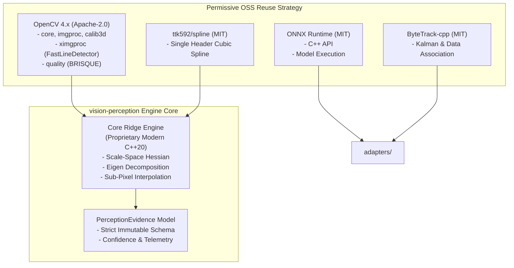

# Open-Source GitHub Reuse Matrix

> **Target Repository**: `vision-perception`  
> **Evaluation Date**: September 2026  
> **Status**: Approved for Architectural Review  

---

## 1. Executive Summary & Selection Philosophy

The `vision-perception` engine is a domain-agnostic, production-grade computer vision core built with modern C++ (C++20) and OpenCV. To balance rapid development with long-term maintainability, commercial viablity, and IP safety, we adhere to strict evaluation criteria:

1. **Permissive Licensing First**: Only software licensed under **Apache-2.0, MIT, BSD (2-Clause or 3-Clause), Boost (BSL-1.0), or zlib** can be directly consumed or dynamically/statically linked without reservation.
2. **Copyleft & Patent Risk Avoidance**: **GPL, AGPL, and proprietary research-only licenses (e.g., CC-BY-NC, non-commercial)** are strictly prohibited from core binaries. LGPL is treated with extreme caution and avoided for static linkage.
3. **No Code Copying Without Provenance**: No third-party source snippet may be vendored without preserving the original license header, commit SHA, and provenance manifest in `docs/license_policy.md`.
4. **Architectural Decoupling**: External dependencies must be isolated behind clean adapter interfaces (`adapters/`) so that the core pipeline (`core/`) remains lean, portable, and free from direct vendor lock-in.

---

## 2. GitHub Reuse Matrix by Category

### 2.1. OpenCV Core Image Processing

| Attribute | Details |
| :--- | :--- |
| **Project Name** | **OpenCV (`core`, `imgproc`, `calib3d`)** |
| **URL** | [https://github.com/opencv/opencv](https://github.com/opencv/opencv) |
| **Purpose** | Fundamental tensor data structures (`cv::Mat`), color-space conversions, morphological filters, 2D convolution, scale-space Gaussian derivatives, and geometric transformations. |
| **License** | **Apache-2.0** (OpenCV 4.5.0+; BSD-3-Clause for legacy branches) |
| **Maintenance Status** | Actively maintained by OpenCV Foundation / Intel; daily commits; robust CI. |
| **Stars / Activity** | ~78k+ stars; extremely high enterprise adoption. |
| **Dependencies** | Minimal core dependencies (optional Eigen, IPP, OpenCL, SIMD backends). |
| **Build System** | CMake 3.x with extensive cross-compilation toolchains (macOS, Linux, Windows, iOS, Android NDK). |
| **Recommended Use** | Primary foundation for basic matrix manipulations, Gaussian blurring, image gradients, and spatial filtering. |
| **Risks** | Massive monorepo footprint if built in entirety. Must configure modular CMake target linking (`opencv_core`, `opencv_imgproc`). |
| **Final Recommendation** | **USE** (Link via target-based CMake: `find_package(OpenCV REQUIRED core imgproc)`) |

---

### 2.2. OpenCV Line Detection

| Project Name | URL | Purpose | License | Build / Deps | Stars / Activity | Recommended Use | Risks | Final Recommendation |
| :--- | :--- | :--- | :--- | :--- | :--- | :--- | :--- | :--- |
| **OpenCV Standard Line Detectors (`HoughLines`, `HoughLinesP`)** | [https://github.com/opencv/opencv](https://github.com/opencv/opencv) | Standard parametric Hough Transform and Progressive Probabilistic Hough Transform for straight line segment extraction. | Apache-2.0 | CMake / OpenCV Core | Core module | Baseline detection for straight structural elements, document borders, or rectangular boundary hints. | Coarse pixel-level resolution; inability to model curvilinear curvature, high false-positive rate on textured ridges. | **USE** (as fast coarse baseline) |
| **OpenCV LineSegmentDetector (LSD)** | [https://github.com/opencv/opencv](https://github.com/opencv/opencv) | Sub-pixel line segment detector based on gradient orientation and a contrario false alarm validation. | Apache-2.0 | CMake / OpenCV Imgproc | Core module | High-precision straight line segment extraction with sub-pixel endpoints. | Formerly subject to patent / licensing discussions in older OpenCV 3.x; strictly linear (cannot detect curved ridges). | **USE** (for polygonal rectification) |
| **Line-Detector (Steger Differential Geometry Reference)** | [https://github.com/rodrigoCastroReyes/Line-Detector](https://github.com/rodrigoCastroReyes/Line-Detector) | C++ implementation of Carsten Steger's "An Unbiased Detector of Curvilinear Structures" using Hessian eigenvalues. | MIT | CMake / OpenCV | Moderate / Reference | Algorithmic reference for sub-pixel curvilinear ridge extraction, directional second derivatives, and Taylor expansion. | Small personal repo; not packaging-ready; needs memory and SIMD optimization. | **EVALUATE LATER** (Use as algorithm reference only; do not vendor directly) |

---

### 2.3. OpenCV Curve Fitting & Spline Interpolation

| Project Name | URL | Purpose | License | Build / Deps | Stars / Activity | Recommended Use | Risks | Final Recommendation |
| :--- | :--- | :--- | :--- | :--- | :--- | :--- | :--- | :--- |
| **OpenCV M-Estimator FitLine (`cv::fitLine`)** | [https://github.com/opencv/opencv](https://github.com/opencv/opencv) | Robust line fitting to 2D/3D point sets using M-estimators (Huber, L1, L1.2, Fair, Welsch). | Apache-2.0 | CMake / OpenCV | Active | Outlier-tolerant piece-wise linear segmentation of extracted ridge points. | Linear only; does not solve polynomial or spline parameterization directly. | **USE** (for piecewise linear segments) |
| **ttk592/spline (`spline.h`)** | [https://github.com/ttk592/spline](https://github.com/ttk592/spline) | Fast, single-header C++ cubic spline library supporting natural, clamped, and periodic boundary conditions. | MIT | Header-only (No deps) | ~1.5k stars; stable | Fitting smooth continuous parametric curves to ordered sub-pixel ridge centerlines. | 1D parameterization $y = f(x)$; parametric curve fitting requires arc-length parameterization $(x(s), y(s))$. | **USE** (Integrate as vendored single header in `third_party/spline/`) |
| **TinySpline** | [https://github.com/msteinbeck/tinyspline](https://github.com/msteinbeck/tinyspline) | Small C/C++ library for NURBS, B-Splines, and Bézier curves with knot vector manipulation and subdivision. | MIT | CMake / No hard deps | ~1.8k stars; active | Advanced arbitrary-dimensional spline smoothing, evaluation, and derivative computation. | Additional API surface if simple cubic splines satisfy requirements. | **EVALUATE LATER** (Adopt if NURBS/B-splines are required for high-degree curvature modeling) |

---

### 2.4. OpenCV ximgproc & FastLineDetector

| Project Name | URL | Purpose | License | Build / Deps | Stars / Activity | Recommended Use | Risks | Final Recommendation |
| :--- | :--- | :--- | :--- | :--- | :--- | :--- | :--- | :--- |
| **OpenCV Contrib `ximgproc::FastLineDetector`** | [https://github.com/opencv/opencv_contrib](https://github.com/opencv/opencv_contrib) | Fast line segment detection alternative to LSD with real-time performance and reduced compute overhead. | Apache-2.0 | CMake / OpenCV Contrib | Highly active | Real-time line candidate generation for coarse alignment and perspective correction. | Still straight-line oriented; requires building `opencv_contrib`. | **USE** |
| **OpenCV Contrib `ximgproc::RidgeDetectionFilter`** | [https://github.com/opencv/opencv_contrib](https://github.com/opencv/opencv_contrib) | Implementation of multi-scale ridge detection filters based on local structure tensors and Gaussian derivatives. | Apache-2.0 | CMake / OpenCV Contrib | Active | Baseline ridge probability map generation and benchmark comparison against Steger pipeline. | Coarse pixel-level mask; lacks sub-pixel unbiased centerline extraction. | **USE** (as comparison baseline in evaluation tools) |
| **OpenCV Contrib `ximgproc::thinning`** | [https://github.com/opencv/opencv_contrib](https://github.com/opencv/opencv_contrib) | Morphological skeletonization algorithms (Zhang-Suen, Guo-Hall). | Apache-2.0 | CMake / OpenCV Contrib | Active | Extracting 1-pixel wide topological medians from binarized ridge or vessel masks. | Pixel-level only (not sub-pixel); sensitive to contour noise and spurious branches. | **USE** (for topological skeleton initialization) |

---

### 2.5. OpenCV Quality Assessment

| Project Name | URL | Purpose | License | Build / Deps | Stars / Activity | Recommended Use | Risks | Final Recommendation |
| :--- | :--- | :--- | :--- | :--- | :--- | :--- | :--- | :--- |
| **OpenCV Contrib `modules/quality`** | [https://github.com/opencv/opencv_contrib](https://github.com/opencv/opencv_contrib) | Image quality metrics: BRISQUE (blind no-reference image quality), SSIM, GMSD, PSNR. | Apache-2.0 | CMake / OpenCV Contrib | Active | Assessing input frame quality, focus degradation, compression artifacts, and perceptual distortion. | BRISQUE requires pre-trained SVM model files (`brisque_model_live.yml`, `brisque_range_live.yml`). | **USE** (with bundled model manifests) |
| **Laplacian Variance Focus Estimator** | Custom Core implementation | Computes focus sharpness via variance of Laplacian operator $\sigma^2(\nabla^2 I)$. | MIT / Apache-2.0 compatible | Header/Source (Pure OpenCV) | Standard industry practice | Gating blurry frames in real-time camera streams before invoking expensive ridge extraction. | Illumination-dependent; requires local contrast normalization. | **USE** (Implement directly in `core/quality/`) |

---

### 2.6. OpenCV Perspective Correction & Document Rectification

| Project Name | URL | Purpose | License | Build / Deps | Stars / Activity | Recommended Use | Risks | Final Recommendation |
| :--- | :--- | :--- | :--- | :--- | :--- | :--- | :--- | :--- |
| **OpenCV `getPerspectiveTransform` & `warpPerspective`** | [https://github.com/opencv/opencv](https://github.com/opencv/opencv) | 4-point perspective planar homography transformation and bilinear/bicubic resampling. | Apache-2.0 | CMake / OpenCV Imgproc | Core module | Canonical ROI rectification, document flattening, and standardizing orientation. | Highly sensitive to corner localization errors. | **USE** |
| **OpenCV `findHomography` & RANSAC** | [https://github.com/opencv/opencv](https://github.com/opencv/opencv) | Robust estimation of planar projective transformation matrix between keypoint correspondences. | Apache-2.0 | CMake / OpenCV Calib3d | Core module | Aligning incoming frames to canonical reference models under perspective distortions. | Requires distinctive point correspondences or corner landmarks. | **USE** |

---

### 2.7. OpenCV Contour Analysis

| Project Name | URL | Purpose | License | Build / Deps | Stars / Activity | Recommended Use | Risks | Final Recommendation |
| :--- | :--- | :--- | :--- | :--- | :--- | :--- | :--- | :--- |
| **OpenCV Structural Analysis (`findContours`, `approxPolyDP`, `convexHull`, `fitEllipse`)** | [https://github.com/opencv/opencv](https://github.com/opencv/opencv) | Topological contour extraction, polygon simplification, convexity defect computation, ellipse fitting. | Apache-2.0 | CMake / OpenCV Imgproc | Core module | Segmenting candidate regions of interest, palm boundaries, egg/poultry silhouettes, and surface defect blobs. | Standard OpenCV contours are integer-grid oriented. | **USE** |

---

### 2.8. ONNX Runtime C++ Inference

| Attribute | Details |
| :--- | :--- |
| **Project Name** | **Microsoft ONNX Runtime (`onnxruntime-cxx`)** |
| **URL** | [https://github.com/microsoft/onnxruntime](https://github.com/microsoft/onnxruntime) |
| **Purpose** | Universal cross-platform C++ deep learning inference runtime for execution of exported neural models (landmark detection, segmentation, classification). |
| **License** | **MIT** |
| **Maintenance Status** | Industry-standard tier 1 maintenance by Microsoft; weekly releases. |
| **Stars / Activity** | ~17k+ stars; massive multi-hardware execution provider support. |
| **Dependencies** | Self-contained C/C++ API; runtime backends (CPU, CoreML on Apple, DirectML on Windows, NNAPI on Android, CUDA/TensorRT on Linux). |
| **Build System** | CMake / Prebuilt distribution archives available for all targets. |
| **Recommended Use** | Primary inference engine for domain packs requiring neural priors (e.g., hand segmentation, landmark estimation). |
| **Risks** | Dynamic library binary size (~20MB–50MB). Can be mitigated using custom minimal operator builds. |
| **Final Recommendation** | **USE** (Wrap cleanly under `adapters/inference/onnx/`) |

---

### 2.9. TensorFlow Lite C++ Inference

| Attribute | Details |
| :--- | :--- |
| **Project Name** | **TensorFlow Lite (`tflite::Interpreter`)** |
| **URL** | [https://github.com/tensorflow/tensorflow/tree/master/tensorflow/lite](https://github.com/tensorflow/tensorflow/tree/master/tensorflow/lite) |
| **Purpose** | Low-latency, quantized mobile/embedded neural network inference engine with hardware delegates (XNNPACK, GPU, NNAPI). |
| **License** | **Apache-2.0** |
| **Maintenance Status** | Actively maintained by Google under TensorFlow / Google AI Edge. |
| **Stars / Activity** | ~185k+ stars across main repo. |
| **Dependencies** | FlatBuffers, Abseil-cpp, XNNPACK. |
| **Build System** | CMake / Bazel. |
| **Recommended Use** | Secondary runtime adapter, specifically targeted at Android NDK and embedded ARM edge platforms. |
| **Risks** | Building C++ TFLite via CMake from source is notoriously cumbersome across OS platforms compared to ONNX Runtime prebuilts. |
| **Final Recommendation** | **EVALUATE LATER** (Prioritize ONNX Runtime first; introduce TFLite adapter in Milestone 4 if mobile benchmarks dictate) |

---

### 2.10. MediaPipe Hand Landmarks

| Attribute | Details |
| :--- | :--- |
| **Project Name** | **Google AI Edge MediaPipe (`mediapipe`)** |
| **URL** | [https://github.com/google-ai-edge/mediapipe](https://github.com/google-ai-edge/mediapipe) |
| **Purpose** | Hand detection and 21 3D hand landmark localization. Critical for the Palm analysis domain pack. |
| **License** | **Apache-2.0** |
| **Maintenance Status** | Actively maintained by Google. Transitioning to Tasks Vision API. |
| **Stars / Activity** | ~28k+ stars. |
| **Dependencies** | Heavy Bazel toolchain, Protobuf, OpenCV, TFLite, OpenGL/Metal. |
| **Build System** | Strictly Bazel (native CMake builds are unsupported or fragile). |
| **Recommended Use** | Consume the exported ONNX / TFLite weights (`hand_landmarker.task`) inside the Palm domain pack, rather than linking the entire MediaPipe Bazel C++ framework into our CMake monorepo. |
| **Risks** | Trying to integrate MediaPipe C++ framework directly creates massive build toolchain conflicts with modern CMake. Model weights are Apache-2.0 and can run via ONNX Runtime / TFLite. |
| **Final Recommendation** | **EVALUATE LATER / ADAPT MODEL WEIGHTS ONLY** (Run models via our native `onnxruntime` adapter; avoid Bazel framework lock-in) |

---

### 2.11. Multi-Object Tracking (ByteTrack & SORT Variants)

| Project Name | URL | Purpose | License | Build / Deps | Stars / Activity | Recommended Use | Risks | Final Recommendation |
| :--- | :--- | :--- | :--- | :--- | :--- | :--- | :--- | :--- |
| **ByteTrack (Official C++ Implementation)** | [https://github.com/ifzhang/ByteTrack](https://github.com/ifzhang/ByteTrack) | High-performance multi-object tracking associating both high and low score detection boxes using Kalman Filter. | MIT | CMake / Eigen3 | ~5.5k stars; active | Tracking multi-agent motion trajectories in poultry tracking and driver monitoring domain packs. | Official repo bundles TensorRT/YOLO samples; C++ library requires isolating tracking kernel. | **USE** (Isolate algorithm into `core/tracking/bytetrack/` or domain pack) |
| **ByteTrack-cpp (Clean Standalone)** | [https://github.com/Vertical-Beach/ByteTrack-cpp](https://github.com/Vertical-Beach/ByteTrack-cpp) | Clean C++17 implementation of ByteTrack tracking core without detection model coupling. | MIT | CMake / Eigen 3.3+ | Stable / Clean architecture | Modular tracker component directly consumable as CMake subproject. | Low commit frequency (essentially finished/stable library). | **USE** (Preferred lightweight reference for C++ tracker adapter) |
| **Norfair** | [https://github.com/tryolabs/norfair](https://github.com/tryolabs/norfair) | 2D multi-object tracking using Kalman filter and distance functions. | BSD-3-Clause | Python / NumPy | Active | Tracking concepts reference. | Python-only; not suitable for zero-dependency native C++ core. | **AVOID** (Python only) |

---

### 2.12. Modern CMake Monorepo Project Templates

| Project Name | URL | Purpose | License | Build / Deps | Stars / Activity | Recommended Use | Risks | Final Recommendation |
| :--- | :--- | :--- | :--- | :--- | :--- | :--- | :--- | :--- |
| **cmake-init** | [https://github.com/friendlyanon/cmake-init](https://github.com/friendlyanon/cmake-init) | Modern, canonical CMake template generator enforcing targets, namespaces, testing, and CPack. | CC0-1.0 (Public Domain) | CMake 3.20+ | ~1.3k stars; active | Reference for robust modern target-based CMake structure (`vision::core`, `vision::adapters`). | Highly opinionated; generator CLI. | **USE** (Adopt target design patterns) |
| **Modern-CMake-Template** | [https://github.com/TheLartians/Modern-CMake-Template](https://github.com/TheLartians/Modern-CMake-Template) | Template for modular C++ projects with GoogleTest, CPM.cmake / FetchContent, coverage, and CI. | MIT | CMake | ~1.4k stars; active | Modular subproject organization for libraries, tools, and tests. | Must ensure external fetching doesn't violate offline hermetic build goals. | **USE** (Adopt directory and test harness layout) |

---

### 2.13. Reusable Computer Vision Pipeline Frameworks

| Project Name | URL | Purpose | License | Build / Deps | Stars / Activity | Recommended Use | Risks | Final Recommendation |
| :--- | :--- | :--- | :--- | :--- | :--- | :--- | :--- | :--- |
| **OpenCV G-API (Graph API)** | [https://github.com/opencv/opencv](https://github.com/opencv/opencv) (in modules/gapi) | Heterogeneous graph execution engine for vision pipelines with memory reuse and kernel pipelining. | Apache-2.0 | CMake / OpenCV | Active | Complex streaming execution graphs across CPU/OpenCL/ONNX. | High learning curve, debugging boilerplate; complex custom kernel registration. | **EVALUATE LATER** (Reserve for Milestone 4+ if pipeline DAG requires hardware stream fusion) |
| **SolAR Framework** | [https://github.com/SolarFramework](https://github.com/SolarFramework) | Modular, interface-driven C++ vision framework for AR/perception pipelines. | Apache-2.0 | CMake / Boost | Research active | Reference for interface-based component decoupling. | Heavy Boost dependency; overly verbose component registry for lightweight edge vision. | **EVALUATE LATER** (Architecture inspiration only) |
| **GStreamer** | [https://gitlab.freedesktop.org/gstreamer/gstreamer](https://gitlab.freedesktop.org/gstreamer/gstreamer) | Industrial multimedia streaming pipeline and hardware encoder framework. | LGPL-2.1+ | Meson / C | Ubiquitous | Camera capture and RTSP streaming ingest in deployment apps. | **LGPL License Risk**: Forbidden for static linkage; introduces GLib/C runtime bloat. | **AVOID** in core (Permissible only as optional isolated OS-level process adapter) |

---

## 3. Summary & Integration Strategy

### Key Decisions:
1. **Curvilinear Ridge Detection**: Build a clean, mathematically rigorous C++20 implementation of Steger's algorithm in `core/ridge/` to guarantee sub-pixel precision and eliminate unverified third-party dependencies.
2. **Inference**: Use `microsoft/onnxruntime` with MIT license as the default ML engine.
3. **Spline Geometry**: Use `ttk592/spline` for cubic spline interpolation.
4. **Tracking**: Adopt the clean C++17 `Vertical-Beach/ByteTrack-cpp` design pattern for multi-object association.
5. **CMake**: Enforce modern target-oriented CMake without global variables.
