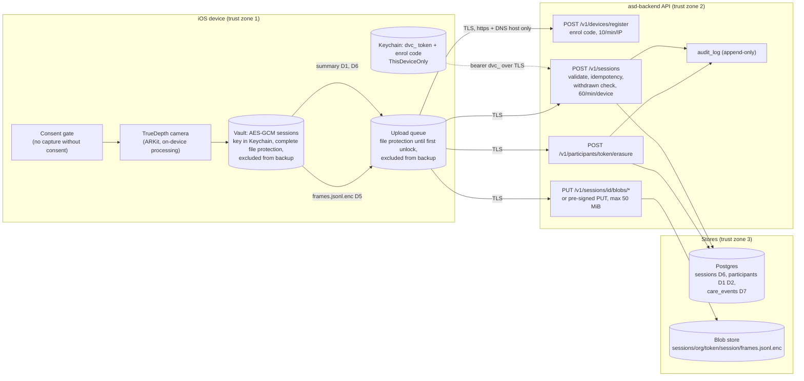
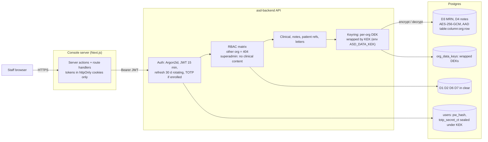
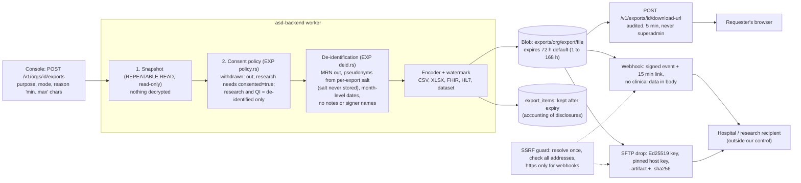
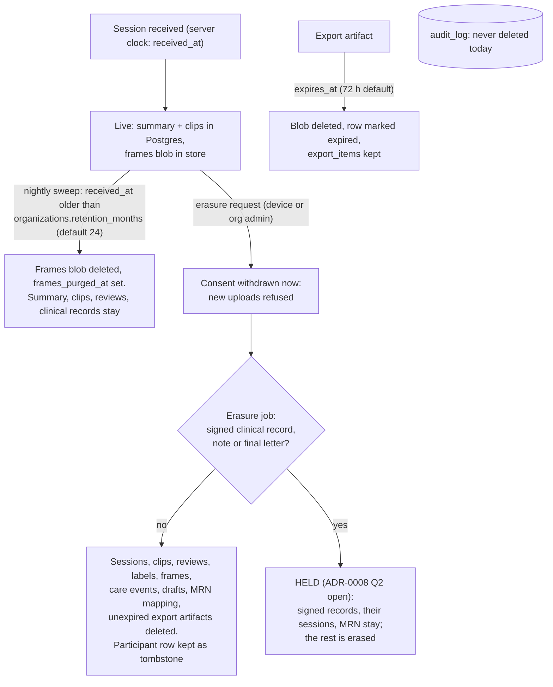

# Data-flow diagrams and data classes

Status: draft for owner review (WP-E.6), 2026-11-01. Companion to `threat-model.md`.
Path shorthand: **BE/** = `rust/crates/asd-backend/`, **EXP/** = `rust/crates/asd-export/`, **IOS/** = `apps/ios_asd_gaze_app/Sources/`, **KIT/** = `domains/asd_screening/ios/Sources/CurvAsdGazeKit/`, **CON/** = `apps/curv_console/`.

## 1. Data classes

| Class | Examples | Identifies a child? | Where stored | Protection at rest |
|---|---|---|---|---|
| **D1 Pseudonymous identifier** | `participantToken` (study participant id, or `child-<8 chars of sessionId>` when not enrolled), participant UUID | Only by linkage. Without enrolment the token is per session, so sessions do not link (`IOS/Models/GazeSessionRecord.swift`) | `participants.token`, session rows | None beyond DB/volume encryption (clear) |
| **D2 Demographics (minimal)** | `age_bracket_at_enrol`, `language`, `consent_version`, `consent_at`, `mode` | Weak | `participants` (`BE/migrations/0001_initial.sql`) | Clear. Cleared on erasure (`BE/src/jobs/erasure.rs`) |
| **D3 Hospital MRN** (opt-in) | MRN plus assigning authority | Yes | `patient_refs.mrn_ct`, `mrn_bidx` (`BE/migrations/0008_clinical.sql`) | MRN: AES-256-GCM under the org DEK. Index: HMAC blind index. Authority code in clear |
| **D4 Clinical notes** | impression, recommendations, amend reason, notes, referral letters, QA review notes | Not by name (no names are stored, ADR-0008 D4) but written about a child | `*_ct` columns in `clinical_review_versions`, `clinical_notes`, `referral_letters`, `review_items.note_ct` | AES-256-GCM under the org DEK, AAD bound to row |
| **D5 Gaze frames** | frame-level gaze samples | Biometric-adjacent | Device vault; uploaded as `frames.jsonl.enc` | Sealed with the device vault key (AES-GCM). The server cannot open it |
| **D6 Scores and summaries** | composite score, dwell ratios, per-clip rows, flag, tracking quality, calibration | Pseudonymous health observation | `sessions.summary` (JSONB), `session_clip_scores` | Clear in Postgres |
| **D7 Care events** | diary, task, medication, milestone payloads | Pseudonymous | `care_events.payload` (JSONB) | Clear in Postgres |
| **D8 Credentials and secrets** | password hash, TOTP seed, refresh/device tokens, enrol codes, webhook and SFTP secrets, KEK, DEKs, signing keys | n/a | see threat model A5 to A9 | Hashes (tokens, codes), Argon2id (passwords), AEAD (seeds, secrets, DEKs); KEK and signing keys in environment |
| **D9 Staff data** | user e-mail, role, last login, audit IP and user agent | Yes (staff) | `users`, `audit_log` | Clear; e-mail masked in logs (`BE/src/telemetry.rs`) |
| **D10 Export artifacts** | CSV, XLSX, FHIR, HL7, dataset files | Identified mode: yes (MRN, token). De-identified: reduced | Blob store `exports/{org}/{export}/{file}` | Relies on bucket encryption; HL7 contains MRN |

Never stored, by design (`docs/roadmap_2026q4/02_asd_backend_architecture.md` section 1, `docs/spec/adr/ADR-0008-clinician-workspace-and-interop.md` D4): video, photos, child name, date of birth, address, phone.

## 2. Diagram A: capture and ingest (device to backend)

Sources: `KIT/SessionVaultManager.swift`, `IOS/Models/ResearchKitSyncService.swift`, `IOS/Models/DeviceCredentialStore.swift`, `IOS/Models/ResearchStudyConfiguration.swift`, `BE/src/routes/devices.rs`, `BE/src/ingest/mod.rs`, `BE/src/routes/blobs.rs`, `BE/src/routes/care.rs`.

Notes:
- TLS is terminated by the proxy, not the app (`threat-model.md` section 2). iOS rejects non-https and IP-literal hosts.
- A participant who withdrew gets `409 participant-withdrawn` and nothing is stored (`BE/src/ingest/mod.rs`).
- The audit row for ingest carries the flag and review reasons only, not the payload (`BE/src/ingest/mod.rs`).

## 3. Diagram B: clinical workspace, keys, and encryption points (console to backend)

Sources: `CON/src/lib/auth/server.ts`, `CON/src/lib/auth/cookies.ts`, `BE/src/auth/`, `BE/src/auth/rbac.rs`, `BE/src/crypto/keyring.rs`, `BE/src/routes/patient_refs.rs`, `BE/src/routes/notes.rs`, `BE/src/routes/clinical_reviews.rs`.

Notes:
- If `ASD_DATA_KEK` is unset, clinical endpoints answer `503 clinical-crypto-unavailable` and an enrolled user's TOTP check also fails closed (`BE/src/crypto/mod.rs`, `BE/src/auth/totp.rs`).
- Plaintext of D3 and D4 exists only in API process memory during a request; the redaction layer drops these field names from logs (`BE/src/telemetry.rs`).

## 4. Diagram C: exports and integrations (backend out to people and hospitals)

Sources: `BE/src/routes/exports.rs`, `BE/src/jobs/export.rs`, `EXP/src/policy.rs`, `EXP/src/deid.rs`, `BE/src/jobs/deliver.rs`, `BE/src/interop/netguard.rs`, `BE/src/interop/webhook.rs`, `BE/src/interop/sftp.rs`.

Notes:
- `identified` mode is allowed only for `clinical_care` and `patient_request` purposes and only for `owner` and `clinician` (or the requester) (`BE/src/auth/rbac.rs`, `EXP/src/policy.rs`).
- Dataset formats are de-identified only, enforced in the database by `exports_dataset_deidentified` (`BE/migrations/0017_privacy_jobs.sql`).
- Once a file is delivered or downloaded, expiry and erasure cannot recall it.

## 5. Diagram D: lifecycle, retention and erasure

Sources: `BE/src/jobs/retention.rs`, `BE/src/jobs/erasure.rs`, `BE/src/jobs/export.rs` (`sweep_expired`), `BE/migrations/0017_privacy_jobs.sql`. Details and open decisions: `retention-policy.md`.

## 6. Where each data class is encrypted, stored, retained, erased

| Class | In transit | At rest (code) | Retention today | Erased by erasure job |
|---|---|---|---|---|
| D1 token | TLS (proxy) | Clear in DB | Kept; tombstone survives erasure so replays stay refused | Row kept as tombstone, other columns cleared |
| D2 demographics | TLS | Clear | No expiry | Cleared (set NULL) |
| D3 MRN | TLS | AES-256-GCM + blind index | Until erasure; no expiry | Deleted, unless participant is held |
| D4 notes and signed reviews | TLS | AES-256-GCM | No expiry; signed records immutable | Unsigned drafts deleted; signed records **held** (Q2) |
| D5 frames | TLS | Device-key sealed blob | Deleted by sweep after `retention_months` | Deleted (unless the session is held) |
| D6 summaries and clips | TLS | Clear | Kept after sweep (aggregate counts) | Deleted (unless held) |
| D7 care events | TLS | Clear | No expiry | Deleted |
| D8 secrets | TLS | See threat model | Rotated manually; no tooling for KEK | n/a |
| D9 staff data, audit | TLS | Clear | No expiry | Audit rows stay (append-only); they hold ids, not child data |
| D10 exports | TLS; 5-min links | Bucket encryption (not set by code) | 72 h default, max 168 h | Unexpired artifacts that included the participant are deleted and marked expired |

Not covered by any job: database backups and snapshots, copies already delivered to recipients, device-side copies (the app has its own delete-all, `IOS/Models/DataDeletionService.swift`).
