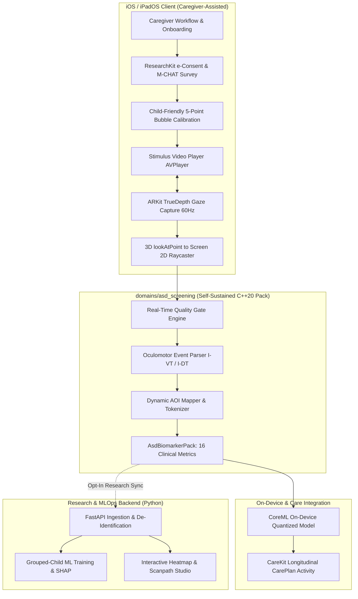

# Architecture Specification: Pediatric Social Attention & ASD Screening

> **Package**: `domains/asd_screening`  
> **Domain Identifier**: `org.curv.domain.asd_screening`  
> **Extraction Readiness**: Standalone Package / Module  
> **Applicable Platforms**: iOS / iPadOS (TrueDepth ARKit), macOS / Linux, Apple ResearchKit & CareKit

---

## 1. Executive Summary & Clinical Scoping

This document specifies the self-contained architecture for the pediatric social visual attention and oculomotor screening domain pack. Grounded in clinical paradigms validated by Duke University's *SenseToKnow* and the FDA-cleared *EarliPoint* system, this pack translates raw mobile eye gaze streams into quantitative biomarkers of social attention variation.

> [!CAUTION]
> **Regulatory & Ethical Positioning**:
> This package is architected strictly as a **Clinical Research & Screening Support Tool (SaMD Class II / Wellness tier)**. It **does not** provide an automated diagnosis of Autism Spectrum Disorder (ASD). ASD diagnosis requires comprehensive developmental and clinical evaluation (ADOS-2, ADI-R) by multidisciplinary pediatric specialists. Outputs are continuous distributions and risk likelihood bands, never deterministic labels.

---

## 2. Component Hierarchy & Module Boundaries



---

## 3. Package Structure & Standalone Extraction Layout

```text
domains/asd_screening/
├── README.md               # Entry point with complete documentation map and usage examples
├── docs/                   # Self-sustained package specifications
│   ├── ARCHITECTURE.md     # This system architecture specification
│   ├── STIMULI_SPEC.md     # Multi-task stimulus battery & dynamic AOI specifications
│   ├── ETHICS_PROTOCOL.md  # IRB protocol, consent, COPPA/HIPAA & calibration protocol
│   ├── ML_ROADMAP.md       # Grouped cross-validation, explainable ML & CoreML export
│   └── LITERATURE.md       # Landmark clinical studies & 12-phase SaMD lifecycle
├── include/
│   └── curv/domains/
│       └── AsdBiomarkerPack.hpp   # Public C++20 domain pack contract
└── src/
    └── AsdBiomarkerPack.cpp       # Pure C++20 implementation (zero external deps)
```

---

## 4. Oculomotor Primitives & Clinical Metrics

### 4.1 Input Telemetry (`GazeSample`)
Captures instantaneous oculomotor telemetry at 60 Hz:

```json
{
  "timestamp_ms": 10420.5,
  "video_time_sec": 4.120,
  "x_norm": 0.4215,
  "y_norm": 0.3180,
  "confidence": 0.94,
  "left_eye_openness": 0.98,
  "right_eye_openness": 0.97,
  "head_pitch_rad": -0.041,
  "head_yaw_rad": 0.082,
  "head_roll_rad": 0.015,
  "distance_to_screen_cm": 48.5,
  "valid": true
}
```

### 4.2 Biomarkers Computed
1. **GeoPref Index**: Preference for dynamic geometric patterns over social interactions.
2. **Facial Core Hierarchy**: Eye, Mouth, Face, and Peripheral dwell ratios.
3. **First-Look Latencies**: Milliseconds to first fixate on eyes or social regions.
4. **Transition Entropy**: Shannon entropy of Markov transitions between visual AOIs.
5. **Repeat Bigrams**: Frequency of circular, restricted scanpath loops.
6. **Spatial Recurrence Rate (RQA)**: Rate of returning to previously inspected coordinates.

---

## 5. Apple Health Ecosystem Integration

- **Apple ResearchKit**: Serializes natively via `toResearchKitJson()` into `ORKActiveStepResult`.
- **Apple CareKit**: Serializes natively via `toCareKitJson()` into `OCKCarePlanActivity` for longitudinal pediatric charts.
