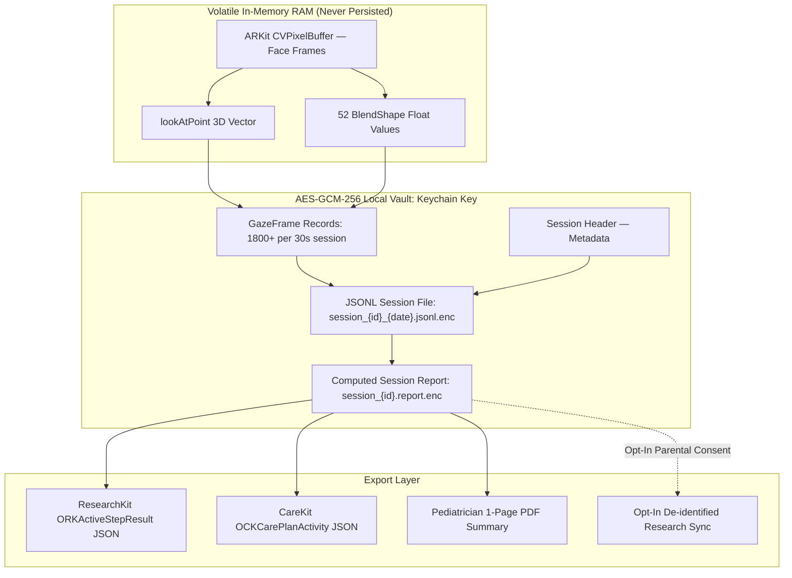
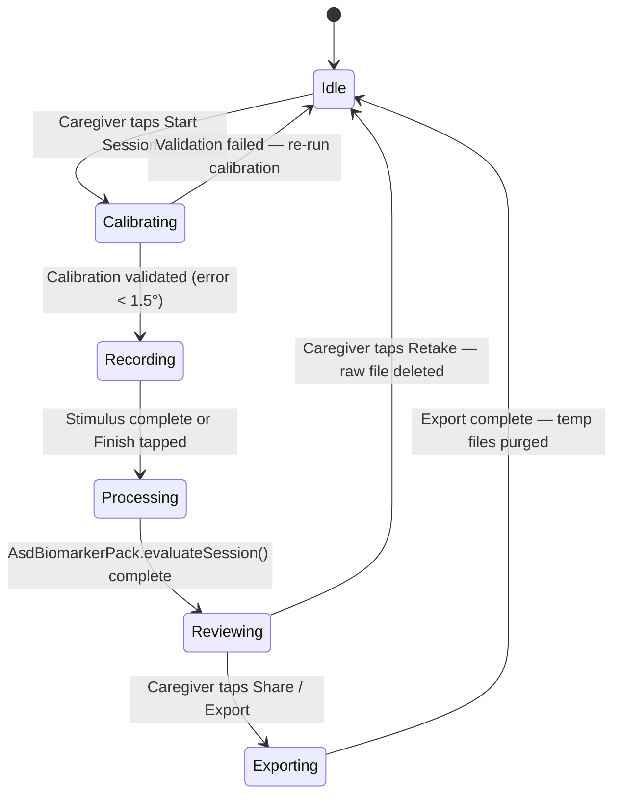

# Data Storage Architecture & Processing Pipeline

> **Package**: `domains/asd_screening`  
> **Document**: `docs/DATA_STORAGE_AND_PIPELINE.md`  
> **Scope**: Complete specification of on-device encrypted storage, session lifecycle, file naming, export contracts, and the offline-first processing pipeline from raw 60 Hz frame telemetry to clinical biomarkers and PDF export.  
> **Privacy Tier**: COPPA / HIPAA compliant — zero raw video, pseudonymous tokens, AES-GCM-256 on-device encryption with a device-bound Keychain key.

---

## 1. Storage Architecture Overview



---

## 2. On-Device File System Layout (App Sandbox)

```text
App Sandbox:
/Library/Application Support/org.curv.asd.gazecollector/
├── vault/                                       # AES-GCM-256 encrypted session vault
│   ├── session_7F8B_2026-09-13.jsonl.enc        # Raw 60 Hz multimodal telemetry
│   ├── session_7F8B_2026-09-13.report.enc       # Computed biomarker report
│   ├── session_A2C4_2026-09-27.jsonl.enc
│   └── session_A2C4_2026-09-27.report.enc
├── calibration/                                 # Per-session calibration state
│   └── calibration_current.json.enc            # Polynomial correction matrix
├── audit/                                       # IRB compliance audit log
│   └── audit_log.jsonl.enc                     # Event log (no gaze data)
└── export/                                      # Temporary staging (auto-purged)
    └── [purged after UIActivityViewController completes]
```

### File Naming Convention

```text
session_{SESSION_ID}_{ISO_DATE}.jsonl.enc
session_{SESSION_ID}_{ISO_DATE}.report.enc
```

| Component | Format | Example |
| :--- | :--- | :--- |
| `SESSION_ID` | First 8 chars of UUIDv4 (non-reversible) | `7F8BC291` |
| `ISO_DATE` | UTC calendar date | `2026-09-13` |
| Extension | `.jsonl` (JSON Lines) + `.enc` (AES-GCM encrypted) | — |

### Key Management (Keychain)

- The AES-GCM-256 vault key is a random `SymmetricKey(size: .bits256)` persisted as a generic-password item in the **iOS Keychain** (`SessionVaultManager.loadOrCreatePersistentKey`), with `kSecAttrAccessibleAfterFirstUnlockThisDeviceOnly`. It is **not** generated in or bound to the Secure Enclave.
- `ThisDeviceOnly` keeps the item out of backups and device migration, so the ciphertext is not readable on another device.
- There is no per-read biometric access control on the key today (no `kSecAccessControlBiometryAny`); files additionally use `.completeFileProtection`.
- If the Keychain item is lost (device reset or app deleted), session data becomes **cryptographically inaccessible** (no recovery — inform caregivers in consent).

---

## 3. Session Lifecycle State Machine



---

## 4. Phase-by-Phase Data Implementation Roadmap

### Phase D1: Frame Capture & In-Memory Buffer ✅ Documented / Ready to Code
*Focus: Every 60 Hz ARKit frame assembles a complete `GazeFrame` record held in a ring buffer.*

- [ ] **D1.1 ARSession Integration**: Start `ARSession` with `ARFaceTrackingConfiguration` on session start. Register `ARSessionDelegate.session(_:didUpdate:)` on a `SerialQueue`.
- [ ] **D1.2 GazeFrame Assembly**: Per-frame, assemble `GazeFrame` from:
  - `ARFaceAnchor.lookAtPoint` → `ScreenRaycaster.projectGazeToScreen()`
  - `ARFaceAnchor.leftEyeTransform`, `rightEyeTransform` → independent eye coordinates
  - `ARFaceAnchor.blendShapes` → `FacialAffectMetrics` (52 FACS values)
  - `ARFaceAnchor.transform` → decomposed pitch / yaw / roll + XYZ translation
  - `StimulusAOITracker.activeAOIs(atTimeSec:xNorm:yNorm:)` → AOI hit test
  - `GazeQualityGate.evaluateSample(_:)` → quality verdict
  - `CADisplayLink` timestamp → `video_time_sec` sync
- [ ] **D1.3 GazeFrameRingBuffer**: Swift `actor GazeFrameRingBuffer` with `capacity: 3600` (60s at 60 Hz). Frames overflow safely on memory pressure (oldest frames dropped, frame_dropped flag set).
- [ ] **D1.4 Stimulus Event Tagging**: Pre-keyed `Dictionary<CMTime, String>` maps stimulus video timestamps to event tags (e.g. `"character_laugh_onset"` at `t = 14.2s`). Applied during ring buffer assembly.
- [ ] **D1.5 Unit Tests**: Verify GazeFrame assembly from synthetic `ARFaceAnchor` data. Verify ring buffer capacity enforcement and frame-drop behavior.

---

### Phase D2: AES-GCM Encrypted Session File Writer
*Focus: Stream-write each frame to disk encrypted, with zero plain-text persistence.*

- [ ] **D2.1 SessionFileWriter Actor**: Swift `actor SessionFileWriter` that:
  - Creates `vault/session_{id}_{date}.jsonl.enc` on session start.
  - Appends `GazeFrame` JSONL lines encrypted per-chunk using `CryptoKit.AES.GCM`.
  - Writes `SessionHeader` as the first encrypted line.
- [ ] **D2.2 Streaming Cipher Strategy**: Evaluate two options:
  - **Option A**: Per-frame IV (simpler, ~32-byte overhead per frame, ~57.6 KB/session overhead).
  - **Option B**: ChaCha20-Poly1305 streaming cipher for the whole file (smaller overhead, preferred).
- [ ] **D2.3 Atomic Flush on Completion**: On session end, flush remaining ring buffer frames, write EOF marker, and close the file handle safely.
- [ ] **D2.4 Storage Budget Gate**: Refuse session start if `FileManager.default.urls(.documentDirectory).availableCapacity < 10_000_000` (10 MB minimum).
- [ ] **D2.5 Unit Tests**: Verify write / read round-trip: write `GazeFrame` records, decrypt, parse JSONL, and assert field equality.

---

### Phase D3: On-Device Biomarker Computation (Emotion + Gaze)
*Focus: After recording ends, decrypt and process all frames to compute clinical metrics.*

- [ ] **D3.1 SessionFileReader**: `SessionFileReader` decrypts `.jsonl.enc` file and streams `GazeFrame` records back into memory.
- [ ] **D3.2 C++ Gaze Biomarker Bridge**: Convert Swift `[GazeTelemetrySample]` from `GazeFrame` array into `std::vector<CurvEngine::temporal::GazeSample>` and call `AsdBiomarkerPack::evaluateSession()` to compute the 16 core gaze metrics.
- [ ] **D3.3 Emotion Biomarker Computation** *(Swift-native, no C++ required)*:
  - **Affect-Gaze Synchrony**: Compute Pearson cross-correlation between `socialSmileIntensity(t)` and `inSocialAOI(t)` indicator signal. Positive correlation = synchronized social smile while looking at social content.
  - **Smile Reactivity Index**: For each `stimulus_event_tag` frame, measure `max(socialSmileIntensity)` within the subsequent 800ms window minus the 500ms baseline before the event.
  - **Flat Affect Score**: Compute variance of `expressivityIndex` across all valid frames. Low variance ($< 0.005$) indicates flat/blunted affect.
  - **Surprise Engagement Index**: Mean `surpriseScore` within 300ms of novel stimulus onset events.
- [ ] **D3.4 Report Serialization**: Serialize combined `AsdSessionReport` + `EmotionBiomarkerReport` as `.report.enc`.
- [ ] **D3.5 Unit Tests**: Verify emotion biomarker computation on synthetic sessions with manually constructed expected cross-correlations.

---

### Phase D4: Export Contracts & Clinical Sharing
*Focus: Generate standardized outputs for pediatrician visits and research upload.*

- [ ] **D4.1 ResearchKit JSON Export**: Serialize `ORKActiveStepResult`-compatible JSON from session report matching `domains/asd_screening` contract:
  ```json
  {
    "identifier": "ORKActiveStepResult",
    "type": "social_attention_gaze_result",
    "biomarkers": { "social_preference_score": 0.48, ... },
    "emotion_biomarkers": { "smile_reactivity_index": 0.32, ... }
  }
  ```
- [ ] **D4.2 CareKit JSON Export**: Serialize `OCKCarePlanActivity` + `OCKOutcome` for developmental milestone chart.
- [ ] **D4.3 PDF Clinical Summary**: Generate 1-page PDF (`PDFKit`) with:
  - Session quality bar.
  - Social Preference Score spectrum bar chart.
  - Key gaze biomarkers table.
  - Smile Reactivity and Flat Affect interpretation.
  - Regulatory disclaimer footer ("Screening support tool only — not a diagnosis").
- [ ] **D4.4 AirDrop / Share Sheet**: Present `.pdf` and optionally `.report.enc` via `UIActivityViewController`.
- [ ] **D4.5 Opt-In Research Sync**: Background `URLSessionBackgroundConfiguration` upload of pseudonymized `.jsonl.enc` to `tools/asd_research_server.py`. Requires explicit per-session re-consent, not a global toggle.

---

### Phase D5: Data Governance, Retention & Audit
*Focus: IRB compliance, caregiver control, and right-to-erasure.*

- [ ] **D5.1 Retention Policy**: Sessions older than `retentionDays` (default: 90 days, IRB-configurable) are auto-deleted: key erased from Keychain + file overwritten with zeros.
- [ ] **D5.2 Manual Session Deletion**: Caregiver can individually delete any session from Dashboard — cryptographic erasure (Keychain key deletion + `FileManager` secure overwrite).
- [ ] **D5.3 Consent Withdrawal Purge**: If caregiver withdraws research consent, all opt-in synced records are flagged for deletion from research server via a pre-issued deletion token.
- [ ] **D5.4 IRB Audit Log**: Maintain a separate `audit_log.jsonl.enc` recording:
  - Session creation timestamps.
  - Export events (to whom, what format).
  - Deletion events.
  - Consent grant / withdrawal events.
  - **Never** stores gaze or affect data.

---

## 5. Storage Budget & Performance Targets

| Metric | Target | Notes |
| :--- | :--- | :--- |
| Frame assembly latency | < 2ms | Must not miss 60 Hz tick |
| Encrypted write latency | < 5ms | Per-frame async write |
| Disk per session (30s) | < 50 KB encrypted | ~42 KB compressed JSONL |
| Max vault size (90 days) | < 200 MB | ~90 sessions × ~50 KB |
| Session biomarker compute | < 3s | Post-session, acceptable UI delay |
| PDF generation | < 2s | On session close |

---

## 6. Schema Versioning & Backward Compatibility

All session files embed `schema_version` in `SessionHeader`. Readers must check this before parsing:

| Version | Changes | Backward Compatible |
| :--- | :--- | :--- |
| `1.0.0` | Initial: gaze + head_pose + quality + stimulus | — |
| `1.1.0` *(current)* | Add 52-field `affect` block + 4 emotion biomarkers | ✅ Readers add zero-default for `affect` |
| `1.2.0` *(planned)* | Binocular vergence angle, pupil dilation estimate | ✅ |
| `2.0.0` *(planned)* | Binary MessagePack encoding | ❌ Breaking — parallel reader required |
