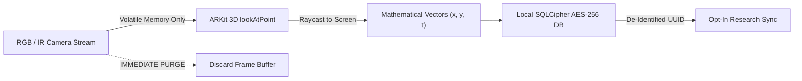

# Pediatric Data Collection Protocol, Ethics & Privacy Specification

> **Package**: `domains/asd_screening`  
> **Document**: `domains/asd_screening/docs/ETHICS_PROTOCOL.md`  
> **Regulatory Alignment**: US COPPA, EU GDPR-K, HIPAA Security Rule, ISO 14971  
> **Target Cohort**: Toddlers (18–48 months) accompanied by legal guardian

---

## 1. Ethical Governance & IRB Protocol

Before engaging pediatric cohorts, data collection must be governed under an approved Institutional Review Board (IRB) clinical protocol:

1. **Study Classification**: Observational, non-invasive digital phenotyping study measuring visual engagement patterns in young children.
2. **Informed Consent**: Captured digitally via Apple ResearchKit (`ORKConsentReviewStep`). A plain-language summary explains:
   - Nature and non-diagnostic purpose of the assessment.
   - Exact sensors utilized (front-facing TrueDepth camera).
   - Absolute guarantee that **raw facial images and camera video are never saved or uploaded**.
   - Voluntary participation: right to pause, exit, or delete session data at any time without penalty.
3. **Child Assent**: If the child shows signs of distress, crying, or persistent turning away, the session is halted immediately.

---

## 2. Privacy by Design & De-Identification



### De-Identification Invariants
- **Zero Raw Video Retention**: Camera frames are processed in volatile RAM buffers. Once raycasting produces $(x, y)$, the pixel buffer is immediately deallocated. No photos or video clips touch flash storage.
- **De-Identified Participant UUID**: Records use salted cryptographic UUIDs. Names and emails never enter the database.
- **Granular Demographic Bucketing**: Age is stored only as an integer count of months (e.g. `26` months), avoiding exact birthdates.

---

## 3. Child-Friendly Animated Calibration Protocol

Standard adult eye-tracking calibrations (staring at static black crosses) fail completely with toddlers. We implement a gamified, dynamic 5-point calibration:

```text
       Target 1 (Top-Left)               Target 2 (Top-Right)
                  Target 3 (Center Bubble)
       Target 4 (Bottom-Left)            Target 5 (Bottom-Right)
```

1. **Visual Cue**: A vibrant, semi-transparent animated bubble floats into the target point and bounces gently.
2. **Audio Reward**: A soft auditory chime plays to attract auditory-visual orienting.
3. **Trigger**: When gaze dwells within $40\text{ px}$ of the target for $\ge 200\text{ ms}$, the bubble pops with a sparkling animation, and the next target appears.
4. **Validation**: If Euclidean error exceeds $50.0\text{ px}$ or valid samples $< 75\%$, a prompt offers one recalibration attempt before proceeding.

---

## 4. Clinical Risk Management Matrix (ISO 14971)

| Risk Event | Severity | Probability | Mitigation Architecture |
| :--- | :--- | :--- | :--- |
| **False Positive (Atypical Score in Typical Child)** | Moderate (Caregiver Anxiety) | Low–Moderate | Cautious, non-diagnostic language: *"Visual attention differs from typical reference patterns. This is NOT a diagnosis. Consult your pediatrician for milestone review."* |
| **False Negative (Typical Score in Autistic Child)** | High (Delayed Intervention) | Low–Moderate | Explicit disclaimer: *"Typical gaze patterns on this test DO NOT rule out developmental concerns. If you have concerns, consult a physician."* |
| **Missing-Data Bias (Child Distracted)** | Moderate (Invalid Metric) | Moderate | Automated Quality Gate rejects sessions with $< 60\%$ valid tracking; prompts caregiver to test later in a calmer environment. |
| **Data Leakage Across Splits** | High (Inflated ML Accuracy) | Low | Architectural enforcement: Grouped cross-validation splits strictly by `child_id` at the database level. |
