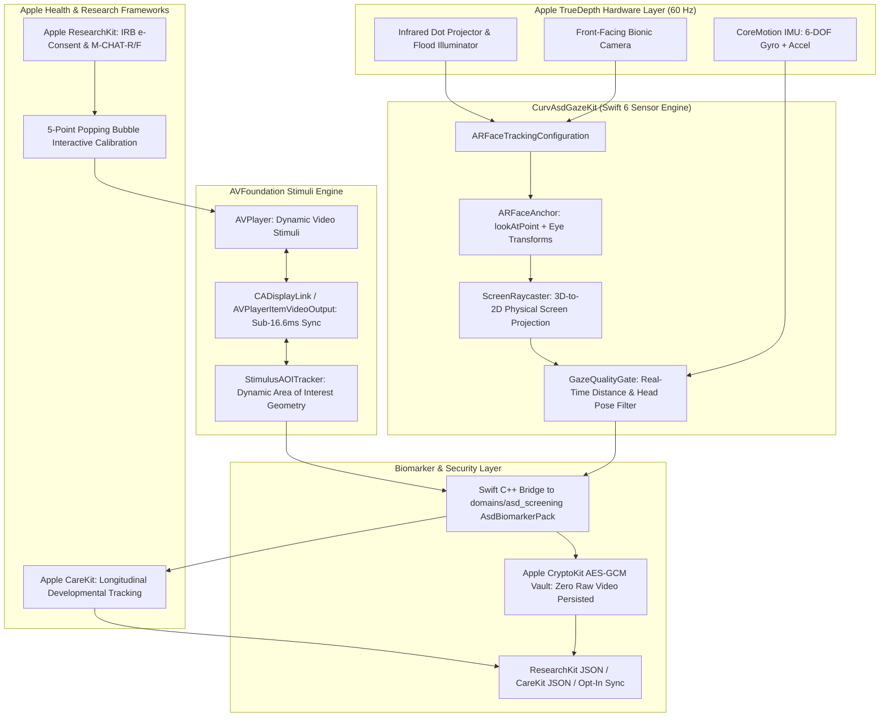

# Native iOS Gaze Data Collection App: Design Guidelines & Phase-by-Phase Roadmap

> **Package**: `domains/asd_screening`  
> **Target App**: `apps/ios_asd_gaze_app` / Framework: `CurvAsdGazeKit`  
> **Architecture**: Swift 6 (Strict Concurrency) + ARKit 6 / TrueDepth + AVFoundation + ResearchKit + CareKit  
> **Design Language**: Liquid Glass Aesthetic (iOS Native, Mobile-First)  
> **Regulatory Tier**: Clinical Research & Screening Support Tool (SaMD Class II / Wellness)  
> **Status**: Active Design & Phase-by-Phase Execution Roadmap  

---

## 1. Vision & Architectural Topology

The **Pediatric Gaze Collector** is a specialized native iOS application designed for clinical research, objective biomarker data collection, and developmental screening in toddlers (aged 18–48 months). 

The app leverages Apple's TrueDepth front-facing sensor array (infrared dot projector and flood illuminator) via ARKit 6 to track 3D ocular axes at 60 Hz without requiring invasive wearable hardware or complex multi-camera laboratory setups.



---

## 2. Core Principles & Design Guidelines

### 2.1 Privacy-by-Design & Zero Raw Video Storage
1. **No Video Recording**: The device's front camera is used strictly in-memory by ARKit for real-time mesh tracking. **No raw video frames (`CVPixelBuffer`) or facial images are ever recorded to persistent disk storage**.
2. **Telemetry Only**: The app persists strictly numerical time-series: $(t, x_{\text{norm}}, y_{\text{norm}}, \text{pitch}, \text{yaw}, \text{confidence}, \text{eye\_openness})$.
3. **Encrypted Local Storage**: Telemetry files are encrypted at rest using Apple CryptoKit (`AES-GCM-256`) with a device-bound Keychain key (not Secure Enclave).
4. **COPPA / HIPAA De-identification**: Participant tokens are random UUIDv4 hashes; no child names or dates of birth are stored alongside gaze telemetry.

### 2.2 Clinical Validity & Sensor Fusion
1. **60 Hz TrueDepth Telemetry**: Raycasting uses `ARFaceAnchor.lookAtPoint` combined with `ARFaceAnchor.leftEyeTransform` and `rightEyeTransform` projected onto the screen surface ($Z = 0$).
2. **Sub-16.6ms Video Synchronization**: `CADisplayLink` or `AVPlayerItemVideoOutput` binds every video frame timestamp directly to the instantaneous gaze sample to eliminate temporal phase jitter.
3. **CoreMotion Gyroscope Compensation**: Device shake and accidental caregiver tilts are separated from child head pose dynamics using `CMMotionManager`.

### 2.3 Child-Centered UI/UX & Liquid Glass Aesthetic
1. **Liquid Glass Design**: Visual tokens consume `@astrofusion/design-language-core` or native iOS translucid blur materials (`.ultraThinMaterial`, `GlassCard`, `GlassInput`).
2. **Caregiver Ergonomics**: High-contrast positioning guides, visual distance meters (target 40–55 cm), and automatic calibration prompts.
3. **Engagement Loop**: Visual stimulus transitions use animated bubbles and rewarding audio chirps to maintain toddler gaze without overstimulation.
4. **Trilingual Localization**: Fully localized in English (`en`), Nepali (`ne`), and Hindi (`hi`).

---

## 3. Phase-by-Phase Implementation Roadmap & Progress Tracker

The implementation is structured into **7 distinct, measurable phases**. Use this section to track progress throughout development:

### Phase 1: Native ARKit TrueDepth Gaze Engine & Screen Raycaster
*Focus: 60 Hz sensor capture, 3D-to-2D screen coordinate projection, and data structures.*
- [x] **1.1 Sensor Session Setup**: Implement `GazeSessionManager` wrapping `ARSession` with `ARFaceTrackingConfiguration` (`isWorldTrackingEnabled = false`, maximum frame rate 60 Hz).
- [x] **1.2 Screen Plane Raycaster**: Implement `ScreenRaycaster` to project `ARFaceAnchor.lookAtPoint` and independent eye transforms onto the device's physical screen coordinates in points and normalized $[0, 1]$ coordinates.
- [x] **1.3 Telemetry Data Model**: Create Swift data structs conforming to `Sendable` and `Codable`:
  - `GazeTelemetrySample` (timestamps, coordinates, 3D head pose, confidence, blink states, distance to screen).
- [x] **1.4 Quality Gate Pre-Filter**: Implement real-time quality filters (face lost, extreme head turn $|\text{yaw}| > 35^\circ$, device tilt $> 45^\circ$, pupil occlusion).
- [x] **1.5 Unit Tests**: Unit tests with synthetic transforms verifying screen raycast precision, coordinate clipping, and quality thresholds.

---

### Phase 2: AVFoundation Synchronized Stimuli Battery
*Focus: Precision video playback, dynamic AOI tracking, and sub-16.6ms sync.*
- [x] **2.1 Video Player Engine**: Implement `StimulusPlayerController` utilizing `AVPlayer` with frame-accurate hardware decoding.
- [x] **2.2 High-Precision Display Link**: Connect `CADisplayLink` (or `AVPlayerItemVideoOutput`) to capture instantaneous `CMTime` on every screen refresh.
- [x] **2.3 Dynamic AOI Evaluator**: Create an in-memory AOI time-coded dictionary matching the clinical stimuli (`StimulusAOITracker`).
- [x] **2.4 Gaze-to-AOI Mapper**: Map instantaneous gaze $(x_{\text{norm}}, y_{\text{norm}})$ directly to active AOI bounding boxes (`Social_Actor`, `Geometric_Pattern`, `Eye_Region`, `Mouth_Region`).
- [x] **2.5 Automated Playback Tests**: Verify temporal alignment between stimulus presentation events and gaze sample timestamps.

---

### Phase 3: Child-Friendly 5-Point Bubble Calibration
*Focus: Fast, engaging calibration to account for individual optical axes.*
- [x] **3.1 Animated Popping Target**: Build a SwiftUI interactive calibration view (`BubbleCalibrationView`) featuring a colorful, pulsing bubble that floats sequentially to 5 screen anchor points:
  - Center $(0.5, 0.5)$, Top-Left $(0.2, 0.2)$, Top-Right $(0.8, 0.2)$, Bottom-Left $(0.2, 0.8)$, Bottom-Right $(0.8, 0.8)$.
- [x] **3.2 Fixation Lock-In Detector**: Automatically detect when the child's gaze fixates on the bubble for $\ge 300\text{ms}$, triggering a bubble "pop" animation and rewarding sound.
- [x] **3.3 Polynomial Calibration Offset**: Compute affine / polynomial calibration correction matrix $(x', y') = M \cdot (x, y)$ to rectify systematic screen gaze error.
- [x] **3.4 Calibration Quality Score**: Compute validation error (target $< 1.5^\circ$ visual angle); prompt for caregiver repositioning if error is elevated.

---

### Phase 4: Apple ResearchKit Integration (e-Consent & Screening Flow)
*Focus: Standardized IRB e-Consent, developmental surveys, and custom active steps.*
- [ ] **4.1 ResearchKit Task Orchestrator**: Build `AsdResearchStudyTask` assembling the complete study sequence:
  - `ORKVisualConsentStep`: Explains purpose, data privacy, and camera handling to caregiver.
  - `ORKConsentReviewStep`: Digital signature capture for parental informed consent.
  - `ORKQuestionStep`: Administers the 20-item M-CHAT-R/F (Modified Checklist for Autism in Toddlers).
- [ ] **4.2 Custom Active Step (`AsdGazeScreeningActiveStep`)**: Wrap the calibration and stimulus battery into an official `ORKActiveStep` and `ORKActiveStepViewController`.
- [ ] **4.3 Result Schema Conformance**: Export results into `ORKActiveStepResult` matching the `domains/asd_screening` JSON contract.

---

### Phase 5: Apple CareKit Integration & Caregiver Dashboard
*Focus: Longitudinal developmental tracking, appointment reminders, and Liquid Glass UI.*
- [ ] **5.1 CareKit Store & Task Architecture**: Implement `OCKStore` tasks for periodic milestone screening (e.g. at 18, 24, and 36 months).
- [x] **5.2 Liquid Glass Caregiver Dashboard**:
  - `CaregiverDashboardView`: Liquid Glass cards (`GlassCard`) displaying completed screenings and scheduled follow-ups.
  - `VisualAttentionTrendCard`: Interactive trend display showing social attention preference stability across developmental sessions.
  - `SessionQualityIndicator`: Explains whether lighting or distance was optimal during the latest session.
- [ ] **5.3 Pediatrician Export PDF**: Generate a clean, 1-page PDF summary for the caregiver to share with their pediatrician during well-child visits.

---

### Phase 6: C++ Engine Integration & CoreML On-Device Model
*Focus: Zero-latency on-device biomarker computation and CoreML inference.*
- [ ] **6.1 Swift-to-C++ Interoperability**: Link `domains/asd_screening` via Swift C++ Interop (`cxxLanguageStandard = "c++20"`):
  - Ingest `std::vector<GazeSample>` into `AsdBiomarkerPack::evaluateSession()`.
  - Receive `AsdSessionReport` with 16 continuous clinical biomarkers.
- [ ] **6.2 CoreML Model Packaging**: Package quantized classification model (`AsdAttentionClassifier.mlpackage`) to compute attention phenotype distributions on the Apple Neural Engine (ANE).
- [ ] **6.3 SHAP Feature Explanation**: Expose the top 3 contributing biomarkers to the caregiver report.

---

### Phase 7: Secure Data Storage, De-Identification & Research Sync
*Focus: HIPAA/COPPA compliance, AirDrop / cloud export, and offline resilience.*
- [ ] **7.1 Apple CryptoKit Local Vault**: Store session telemetry in an encrypted local sandbox using `AES-GCM-256`.
- [ ] **7.2 AirDrop & Files Exporter**: Caregiver/Clinician manual export to secure research drive via iOS Share Sheet (`UIActivityViewController`).
- [ ] **7.3 Opt-In Research API Sync**: Background upload of de-identified JSONL payloads to the Rust ASD backend (`rust/crates/asd-backend`; the Python research server was removed) using `URLSessionBackgroundConfiguration` (offline-first queue).
- [ ] **7.4 Comprehensive End-to-End Test**: Simulate complete workflow from consent $\to$ calibration $\to$ stimuli $\to$ report $\to$ export.

---

## 4. UI/UX Design System (Liquid Glass Aesthetic)

The user interface strictly implements the **Liquid Glass** aesthetic:
- **Base Surface**: Translucent blurred materials (`.ultraThinMaterial` on iOS) layered over deep twilight canvas (`#080C14` to `#121B2A`).
- **Standardized Rounding**: Continuous corners (`RoundedRectangle(cornerRadius: 16, style: .continuous)`).
- **Color Semantics**:
  - Social Focus / Calming Primary: Celestial Teal (`#00D2C4`)
  - Distance Guidance / Warning: Warm Amber (`#FFB74D`)
  - Target Calibrated / Success: Emerald Mint (`#00E676`)
  - Stimuli Background: Pure Jet Black (`#000000`) to prevent reflection and child distraction.
- **Accessibility**: Minimum touch targets $\ge 44 \times 44\text{ pt}$, dynamic type scaling, and multi-language support (English, Nepali, Hindi).

---

## 5. Directory Structure in Monorepo

```text
domains/asd_screening/
├── README.md                           # Self-sustained package manifest
├── docs/
│   ├── ARCHITECTURE.md                 # Core C++ and data flow spec
│   ├── IOS_APP_DESIGN_AND_ROADMAP.md   # This iOS native app guide & tracker
│   ├── STIMULI_SPEC.md                 # Stimuli video & AOI schemas
│   ├── ETHICS_PROTOCOL.md              # IRB, consent, and privacy
│   ├── ML_ROADMAP.md                   # Model training and validation
│   └── LITERATURE.md                   # Clinical papers and 12 phases
└── ios/                                # Reusable Swift 6 package
    ├── Package.swift                   # CurvAsdGazeKit manifest
    ├── Sources/CurvAsdGazeKit/
    │   ├── GazeTypes.swift             # Telemetry & AOI data models
    │   ├── ScreenRaycaster.swift       # 3D ARFaceAnchor to 2D screen math
    │   ├── GazeQualityGate.swift       # Posture, distance, and lighting checks
    │   └── StimulusAOITracker.swift    # Time-coded AOI bounding box evaluator
    └── Tests/CurvAsdGazeKitTests/
        └── ScreenRaycasterTests.swift  # Precision unit tests

apps/ios_asd_gaze_app/                  # Application host
├── README.md                           # XcodeGen & setup guide
├── project.yml                         # XcodeGen project specification
└── Sources/
    ├── App/AsdGazeApp.swift            # SwiftUI app entry point
    ├── UI/LiquidGlassTheme.swift       # GlassCard, GlassInput & color tokens
    └── Views/
        ├── CaregiverDashboardView.swift  # Longitudinal milestone view
        ├── BubbleCalibrationView.swift   # Interactive 5-point bubble target
        └── StimulusScreeningView.swift   # AVPlayer + real-time gaze overlay
```
